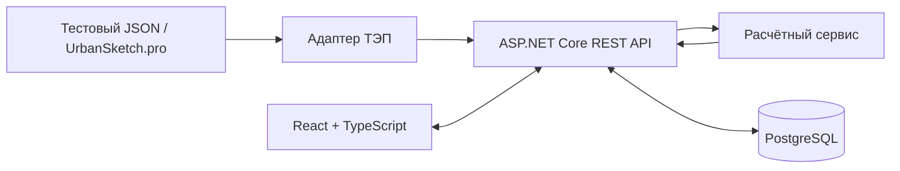

# 05. Архитектура и технологический стек
**Статус:** проектное техническое решение до утверждения с заказчиком.

## Планируемый стек
- React + TypeScript, Vite и Tailwind CSS; shadcn/ui можно подключить по необходимости.
- ASP.NET Core (предварительно .NET 10) для REST API.
- PostgreSQL для хранения моделей и результатов; EF Core возможно во втором спринте.
- На время учебного прототипа ТЭП поступают из подготовленного JSON.

Согласно исходному ТЗ .NET/React/PostgreSQL указаны как основной стек, React Router и EF Core — опциональны. Версии не закреплены в исходном ТЗ. Утверждение конкретной версии .NET и окружения вынесено в открытые вопросы.

## Компоненты
1. **Frontend**: четыре экранных состояния (исходные данные, параметры, результаты, сравнение), формы и визуализации.
2. **REST API**: ресурсы проектов/концепций/финансовых моделей, вызов расчёта, получение сравнения. Реализуется по спринтам 2–4.
3. **Domain/Calculation**: отдельные функции или сервисы расчётов без UI-зависимостей; реализуются в спринте 3.
4. **Persistence**: PostgreSQL; миграции и CRUD со спринта 2.
5. **Source adapter**: `JSON → нормализованная модель ТЭП`; в будущем можно заменить на адаптер API платформы.

## Схема взаимодействия

## Логическая структура сущностей
`Project (1) -> (N) ConceptVariant (1) -> (N) FinancialModel`. У каждой `FinancialModel` есть `FinancialInputs`, набор `AnnualAllocation` и рассчитанные `AnnualCashFlow` / `FinancialResult`. Подробная проектная схема в `database/erd.mmd`, DDL — в `database/schema.sql`.

## Проектные будущие REST-маршруты (не реализованы)
- `GET /api/projects` — список проектов и концепций (спринт 2).
- `GET /api/variants/{id}/tep` — ТЭП варианта (спринт 2).
- `GET/POST/PUT/DELETE /api/financial-models...` — CRUD (спринт 2).
- `POST /api/financial-models/{id}/calculate` — расчёты (спринт 3).
- `POST /api/financial-models/compare` — сравнение (спринт 4).
- `GET /api/financial-models/{id}/export.csv` — CSV (спринт 5).

Указанные контракты **проектные**, структура DTO и коды ошибок окончательно уточняются перед реализацией.

## Безопасность и эксплуатация
- Не включать секреты подключения БД в репозиторий, `.env` исключать из Git.
- Ограничить доступ к БД локальной средой; на сервере использовать отдельную конфигурацию.
- Авторизация не описана в исходном ТЗ — нельзя утверждать, что реализована.
- На первом спринте проверяется запуск каркасов; не реализуются production-развёртывание, интеграция, вычисления или сохранение.
